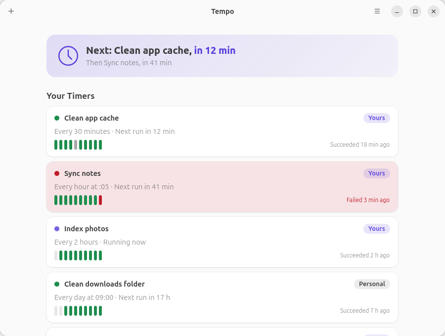

# Tempo

See and manage your systemd **user timers** from a native GNOME app: when each
one runs next, how its last runs went, their logs, and a form to create new
ones from a script or a program you drop on the window.

Written in Rust with GTK 4 and libadwaita, it talks to systemd over D-Bus and
reads its journal through `journalctl`. No Electron, no web view, no cron.



## What it does

- **Lists your timers** with their state, the schedule in plain words, the next
  run, a strip of the last ten runs and who owns each: *Yours* (written by
  Tempo), *Personal* (written by hand in your folder) or *System* (provided by
  the system or an app, Snap included).
- **Shows the logs** of a timer and of its service, live, with a “Problems Only”
  filter, Copy and Save.
- **Creates a timer from a file.** Drop a script or a program on the window, or
  choose one: Tempo looks at it without running it (what it is, interpreter,
  executable bit, Windows line endings, a location that may disappear, `sudo`,
  waiting for the keyboard…), then fills a form: schedule, conditions (only if a
  program is not running, on mains power, a file exists), options (catch up,
  spread, low priority, time limit). It can keep a copy of the file, check the
  result with `systemd-analyze` before installing it, and run the command once
  so you see what it says.
- **Tells you when a run fails.** A desktop notification says which timer
  failed and why, even when Tempo is closed: systemd starts it
  (`OnFailure=`), and a click opens Tempo. On by default for a new timer.
- **Changes and controls the timers it wrote:** Run Now, Pause, Resume, Turn
  Off, Turn On, Edit, and Delete with Undo.
- **Never touches the others.** For a system or personal timer it shows what it
  does and gives the exact command to stop, disable or mask it, with a Copy
  button.

English and French, light and dark, from a 360 px window to a wide one.

## Requirements

Ubuntu 24.04 or later (or any distribution with systemd 250+), GNOME with GTK
4.14 and libadwaita 1.5, and `journalctl`, `systemd-analyze` and `systemd-run`
(part of systemd).

## Build and run

```sh
sudo apt install libgtk-4-dev libadwaita-1-dev gettext desktop-file-utils   # Ubuntu / Debian
make run                # cargo run -p tempo
make dev-install        # desktop entry and icons in ~/.local, for the dock icon
sudo make install       # release build installed under /usr/local
```

`make check` runs the format check, clippy, the tests and the desktop file
check. `make screenshots` redraws `docs/screenshots` from made-up timers.

## Keys

| Key | Does |
|---|---|
| `Ctrl+O`, `Ctrl+N` | Choose a file to make a timer from |
| `F5`, `Ctrl+R` | Read systemd again |
| `Esc`, `Alt+←` | Back |
| `Ctrl+Q` | Quit |

## What Tempo touches

- Only your user systemd (`systemctl --user`): never the system's, never root.
- It writes only `~/.config/systemd/user/<name>.timer` and `.service` for the
  timers it creates, recognised by `X-Tempo-*` keys, the notifier they share
  (`tempo-notify@.service`), and copies of files in
  `~/.local/share/tempo/scripts/<name>/`. Before any action on a timer it checks
  again that both files are its own.
- A file you choose is read (its permissions and its first 64 KiB), never run,
  except by the explicit “Try It…” button after a confirmation.

## For developers

See [AGENTS.md](AGENTS.md), [docs/ARCHITECTURE.md](docs/ARCHITECTURE.md),
[DESIGN.md](DESIGN.md) and [docs/PLAN.md](docs/PLAN.md).

```sh
cargo test --workspace
cargo test -p tempo live_ -- --ignored --test-threads=1   # real systemd: writes then removes test timers
TEMPO_DEMO=1 cargo run -p tempo      # the preview, on made-up timers
TEMPO_PRINT=1 target/debug/tempo     # the real timers, as text
TEMPO_REVIEW=<file> target/debug/tempo   # what the review says of a file
```

## Licence

GPL-3.0-or-later. See [LICENSE](LICENSE).
